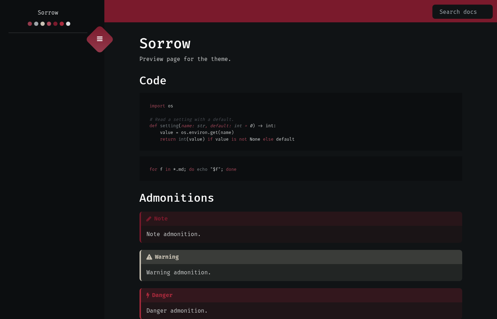

<p align="center">
  
</p>

<p align="center">
  <a href="https://pypi.org/project/mkdocs-sorrow-theme/"></a>
  <a href="https://github.com/MHS-20/sorrow-mkdocs-theme/actions/workflows/release.yml"></a>
  <a href="https://github.com/MHS-20/sorrow-mkdocs-theme/actions/workflows/docs.yml"></a>
  <a href="https://mhs-20.github.io/sorrow-mkdocs-theme/"></a>
</p>

# mkdocs-sorrow-theme

An MkDocs theme in the palette inspired from Omarchy **Solitude** theme. It is based on
the [Dracula theme for MkDocs](https://github.com/dracula/mkdocs): it keeps
Dracula's layout and replaces its colors and code highlighting.

See the live demo at <https://mhs-20.github.io/sorrow-mkdocs-theme/>.

<p align="center">
  
</p>

## Install

```sh
pip install mkdocs-sorrow-theme
```

Then, in `mkdocs.yml`:

```yaml
theme:
  name: sorrow
  favicon: assets/favicon.ico  # optional; defaults to the Sorrow icon
  logo: assets/logo.png        # optional sidebar logo
```

`highlightjs` (default `true`) and `hljs_languages` control highlight.js.
There is no footer and no option to load other highlight styles.

`mermaid: true` (default `false`) renders fenced `mermaid` blocks as diagrams
colored from the theme's tokens; `mermaid_version` (default `11.4.1`) picks the
Mermaid release loaded from jsDelivr. Plain fences work as they are, and so
does a `pymdownx.superfences` custom fence that outputs `<div class="mermaid">`.

Scripts in `extra_javascript` keep their `type`, `async` and `defer` settings.

## How it works

The Dracula templates and layout assets are copied into this package rather
than inherited with `extends: dracula`, because MkDocs copies every file of a
parent theme into the built site. Copying lets the theme leave out Dracula's
highlight stylesheet, logo, favicon, footer and color tokens.

- `base.html` and `modules/`: Dracula's templates. The sidebar divider uses
  the sidebar color, the favicon defaults to the Sorrow icon, and
  the footer is removed. CSS classes use the prefix `sorrow-` instead of
  `drac-`.
- `assets/css/sorrow-ui.css`, `assets/css/mkdocs.min.css`: Dracula's
  stylesheets without its color tokens; admonition tints read the tokens.
- `assets/css/sorrow.css`: the color tokens.
- `assets/css/sorrow-highlight.css`: highlight.js colors following Omarchy's
  syntax mapping (`default/themed/helix.toml.tpl`).

## Palette

| Token | Sorrow key | Color |
| --- | --- | --- |
| `--black` (sidebar, code) | `dark_background` | `#0c0e10` |
| `--blackSecondary` (page) | `background` | `#101315` |
| `--greyTernary` (text) | `foreground` | `#cacccc` |
| `--white` | `yellow` | `#d9dbdc` |
| `--grey` | `selection` | `#3d1621` |
| `--greySecondary` | `muted` | `#4b4e55` |
| `--purple` | `accent` | `#7a1a2c` |
| `--cyan` | `cyan` | `#943a4c` |
| `--green` | `green` | `#9fa5a9` |
| `--orange` | `bright_yellow` | `#c9c2b4` |
| `--pink` | `magenta` | `#a8495b` |
| `--red` | `bright_red` | `#a82a3c` |
| `--yellow` | `yellow` | `#d9dbdc` |

The four reds are darker than the Sorrow originals. Lighter and translucent
variants are derived with `color-mix()`.

## Develop

```sh
uv venv && uv pip install -e .
uv run mkdocs serve
```

The demo site is built from `docs/` and `mkdocs.yml`. Every push to `main`
deploys it to GitHub Pages through `.github/workflows/docs.yml`.

## Release

Releases are automated by `.github/workflows/release.yml` on every push to
`main`. semantic-release reads the Conventional Commits since the last tag,
following `.releaserc.json`: `feat` releases a minor version, `fix` a patch,
and a breaking change a major. It then tags the commit (`vX.Y.Z`) and creates
the GitHub release. A final job builds that tag and publishes it to PyPI
through trusted publishing, so no API token is stored. The package version
comes from the git tag through `hatch-vcs`.

## Credits

Released under the MIT License. Built on the MIT-licensed [Dracula theme for MkDocs](https://github.com/dracula/mkdocs).
